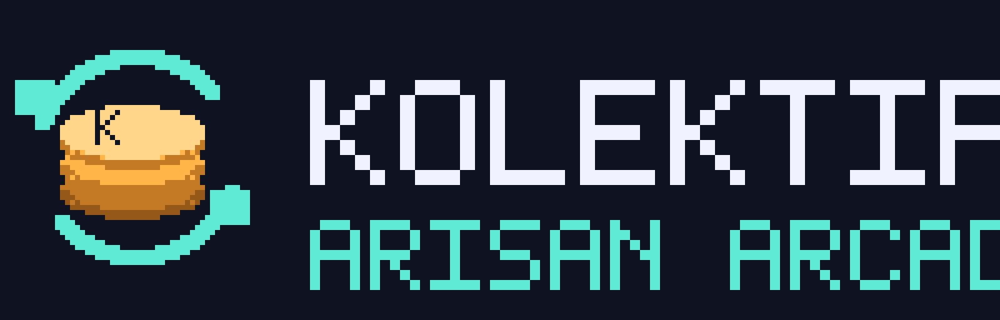
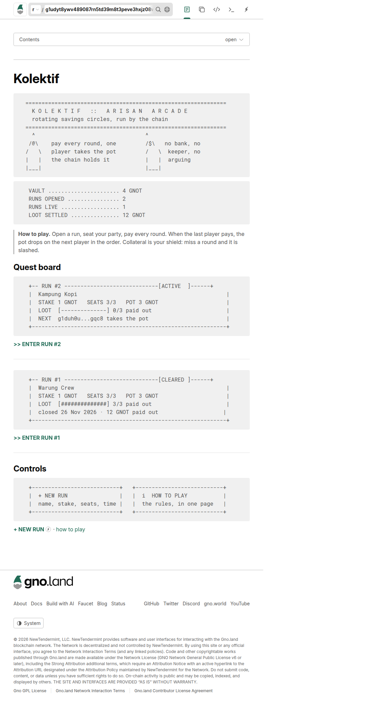
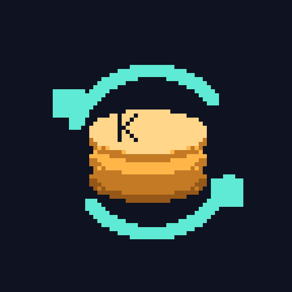
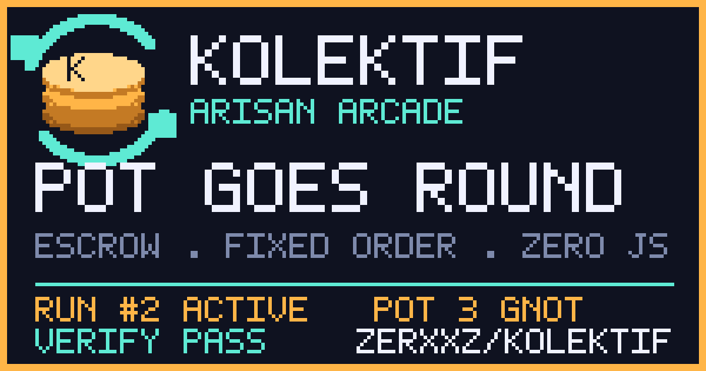

<p align="center">
  
</p>

<h1 align="center">Kolektif</h1>

<p align="center">
  <b>Rotating savings circles, on chain.</b><br>
  A ROSCA — <i>arisan</i>, <i>tanda</i>, <i>chit fund</i>, <i>susu</i> — that runs entirely on
  <a href="https://gno.land">gno.land</a>, with the group's money held by a realm instead of by a treasurer.
</p>

<p align="center">
  
  
  
</p>

<p align="center">
  <a href="https://onyx.testnets.gno.land/r/g1udyt8ywv489087rn5td39m8t3peve3hxjz08w2/kolektif"><b>Live on Gno.land testnet (onyx-1) →</b></a><br>
  <code>https://onyx.testnets.gno.land/r/g1udyt8ywv489087rn5td39m8t3peve3hxjz08w2/kolektif</code>
</p>

<p align="center">
  
</p>

> Three neighbours, 1 GNOT per round, three rounds: everyone pays 3 GNOT,
> everyone takes the 3 GNOT pot home once, and the order is fixed by chain
> state so nobody can rig it.

No bank, no interest, no admin, no off-chain ledger, no frontend. The realm's
`Render` function **is** the app.

---

## Why a ROSCA

Most of the world saves without a bank by rotating a pot between people who
already trust each other. It works, and it fails in exactly two ways:

1. **The treasurer runs off with the pot.** → Kolektif holds the pot in a realm
   whose payouts are checked before every send.
2. **The order is disputed.** → Kolektif derives the payout order from chain
   state at activation; the creator has no lever over it.

A ROSCA is also the honest shape of a first on-chain app: no oracle, no
liquidation engine, no counterparty beyond the group. The pot is the group's own
money rotating — so "does this balance?" is a property you can prove, not hope.

## How a circle runs

| Step | Function | What happens |
|---|---|---|
| Open | `Create(name, contribution, size, roundSpan)` | free; records the circle's economics |
| Join | `Join(id)` + collateral | locks exactly one contribution as collateral |
| Activate | automatic on the last join | payout order fixed from `sha256(id \| height \| sorted members)` |
| Pay | `Contribute(id)` | one contribution; the **last payer** releases the pot |
| Settle | `Advance(id)` | after the deadline, anyone can default non-payers |
| Close | automatic | collateral returns; the penalty fund is split among honest members |

### The four invariants the code enforces

1. **Exact money in.** A payment must carry exactly the collateral or the
   contribution (`requireExact`); a stray amount reverts the whole transaction.
2. **No overpay, ever.** Every payout subtracts from that circle's own `Pool`
   before the send, and the realm panics if a payout would exceed it.
3. **No rigged order.** The order is a Fisher–Yates shuffle over
   `sha256(circle id | activation height | sorted member addresses)`. It cannot
   be chosen by the creator, and every replay derives the same order.
4. **Defaults cost exactly one collateral.** After the deadline, `Advance`
   marks non-payers as defaulted, moves their collateral into a penalty fund,
   drops them from the payout order, and releases the pot from what was actually
   collected. Honest members share the penalty fund at close.

With no defaults, a member's net is **exactly zero**: they pay `size`
contributions, receive one pot of `size` contributions, and get the collateral
back. That is asserted end-to-end in the test suite, including realm balance
going to zero at close.

## The reusable half: `p/…/kolektif/rosca`

The economics live in a dependency-free pure package any realm can import:

```gno
import "gno.land/p/g1udyt8ywv489087rn5td39m8t3peve3hxjz08w2/kolektif/rosca"

params := rosca.Params{Contribution: 1000000, Collateral: 1000000, Size: 5, RoundSpan: 604800}
if err := params.Validate(); err != nil { /* ... */ }

seed  := rosca.Seed(circleID, runtime.ChainHeight(), memberAddresses)
order := rosca.Order(len(memberAddresses), seed)   // deterministic permutation
pot   := params.Pot()                              // size * contribution
share := rosca.Split(penalty, len(honest))         // exact, no dust
label := rosca.Gnot(1500000)                       // "1.5"
```

It has no state and no realm capability, so it is safe to import from a DAO, a
credit union, a savings group inside a game, or a payroll realm that pays in
rounds. The reference realm in this repo imports exactly these helpers: nothing
about the schedule logic is duplicated.

**Read-only API for integrators** (no transaction, no import cycle):

```gno
kolektif.CircleCount()                             // uint64
kolektif.CircleSummary(id)                         // name, contribution, size, round, status, pool
kolektif.IsMember(id, addr)                        // bool
kolektif.Standing(id, addr)                        // roundsPaid, defaulted, received, collateral
kolektif.GlobalStats()                             // circles, active, escrowed, paidOut
```

A gating realm can therefore require "address is a member in good standing of
circle #7" before letting it vote, borrow, or claim a role.

## Demo

**[Watch the 79s walkthrough (1080p, voice-over)](https://github.com/Zerxxz/kolektif/releases/download/v0.2.0-demo/kolektif-demo-vo.mp4)** —
the realm on screen the whole time: open a run → seat three players → pay three rounds →
the last payer releases the pot → collateral returns and the run closes at zero.

`demo/demo-kolektif.mp4` ([direct link](https://raw.githubusercontent.com/Zerxxz/kolektif/master/demo/demo-kolektif.mp4)) — same cut, from the real UI: index → an
active circle → a completed circle, with the realm doing the escrow in between.
Recorded on a local `gnodev` chain (`demo/record_demo.sh` drives it; the same
pages are served by the onyx deployment once the packages are enabled).

| File | What it shows |
|---|---|
| `screenshots/01-index.png` | stats, open and completed circles |
| `screenshots/02-circle-active.png` | pot due, deadline, who has paid |
| `screenshots/03-circle-complete.png` | three pots paid, collateral returned, residual 0 |
| `screenshots/04-rules.png` | the payout-order guarantee |
| `screenshots/05-about.png` | why a ROSCA, and the read-only API |

## Repository layout

```
gno.land/p/<addr>/kolektif/rosca/   pure package: maths, schedule, formatting
gno.land/r/<addr>/kolektif/         realm: state machine, escrow, rendering
  ├─ types.gno        Circle / Member / Payout + derived getters
  ├─ circle.gno       Create, Join, Contribute, Advance, Leave, Cancel
  ├─ api.gno          read-only surface for other realms
  ├─ render.gno       every page, Markdown only, no JS
  └─ *_test.gno       lifecycle, defaults, guards, rendering
demo/run_demo.sh      drives a full circle on a local gnodev chain
screenshots/          rendered pages (gnoweb)
```

## Run it locally

```sh
# 1. toolchain (release binaries, no Go build)
mkdir -p ~/gno-bin && cd ~/gno-bin
for b in gno gnokey gnodev; do
  curl -sL -o $b https://github.com/gnolang/gno/releases/download/v1.8.0/${b}_linux_amd64
  chmod +x $b
done

# 2. GNOROOT, or the release binaries cannot find the stdlibs
git clone --depth 1 --filter=blob:none --sparse https://github.com/gnolang/gno.git ~/gno-src
cd ~/gno-src && git sparse-checkout set examples gno.land/p gnovm misc
export GNOROOT=$HOME/gno-src

# 3. test
cd /path/to/this/repo && gno lint ./... && gno test ./...

# 4. a local chain with three funded members
gnokey add alice -home ~/.gno/demo   # (and bob, carol)
gnodev . -home ~/.gno/demo \
  -add-account alice=80000000000ugnot \
  -add-account bob=80000000000ugnot \
  -add-account carol=80000000000ugnot
# then, in another shell:
./demo/run_demo.sh
# → http://127.0.0.1:8888/r/<addr>/kolektif
```

## Deployed

| What | Path | Transaction |
|---|---|---|
X
| `kolektif` realm | `gno.land/r/g1udyt8ywv489087rn5td39m8t3peve3hxjz08w2/kolektif` | `lsn2zmI0fBFa+hQ1NSbe1CzgOYYNGA0GORcNaWBeDqU=` |

Chain: **onyx-1** (current gno.land testnet), submitted at heights 1,361,013 and
1,361,023. onyx runs with `code_submission_policy=inert`, so a submitted package
stays parked until the chain's approval oracle enables it; see `DEPLOY.md`.

## Tests

`gno test ./...` runs 24 tests: schedule determinism and permutation validity,
penalty splitting, GNOT formatting, the full three-member lifecycle (net zero
for every member, realm balance empty at close), default slashing with
conservation of value, double-payment, deadline and exact-collateral guards,
cancellation/refund paths, and a render smoke test over every page.

## Roadmap

- **Seats as transferable positions**: a member who needs out before their turn
  sells the seat (with the realm's escrow enforcing the price), instead of
  defaulting.
- **Reputation across circles**: `Standing` already reports defaults; a
  composable score lets a circle require "no defaults in your last two circles".
- **Round clock from block time**: already used; a keeper-free milestone view of
  `Advance` for circles whose members are not online at the deadline.
- **Multi-denomination pots**: the package is denom-agnostic; the realm
  hard-codes `ugnot` today.

## Deployment status

onyx-1 runs `code_submission_policy=inert`: a submitted package is stored but not
enabled until the chain's approval oracle or an approver enables it. The current
state, every transaction and what the chain reported are in
[DEPLOY_STATUS.md](DEPLOY_STATUS.md).

## Source

https://github.com/Zerxxz/kolektif

## License

MIT. Built for the Gnome Tavern hackathon (gno.land, November–December 2026).

## Brand

<p>
  
  A stack of coins inside two rotation arrows: the pot that goes round, drawn at 1x and upscaled with
  NEAREST so the pixel grid stays honest. Every asset is generated by code, not by an image model, so a
  rename or a palette change is one command away.
</p>

<br clear="left">

| Asset | Size | Use |
|---|---|---|
| [`brand/kolektif-logo.png`](brand/kolektif-logo.png) | 1600×512 | README banner, listing header |
| [`brand/kolektif-logo-dark.png`](brand/kolektif-logo-dark.png) | 1600×512 | same lockup on pure black |
| [`brand/kolektif-mark.png`](brand/kolektif-mark.png) | 576×576 | square avatar / favicon |
| [`brand/kolektif-social-card.png`](brand/kolektif-social-card.png) | 1200×630 | DoraHacks thumbnail, posts |

<p>
  
</p>

Regenerate with `python3 tools/make_logo.py` (Pillow, no network). The generator self-tests its
5×7 glyph table and width-checks every string before writing, so a missing letter or an overlong
line fails the build instead of silently clipping a word.

## Spectating and verifying a run

Every run has a proof page: `:circle/<id>/party` prints the payout order, the seed it came from,
its sha256, the activation height, and a `VERIFY v1` block for machines. The run page links to it
from its **Proof** section.

```sh
python3 scripts/verify_order.py --rpc https://rpc.onyx.testnets.gno.land:443 --circle 2
```

The script rebuilds the Fisher-Yates order from the seed (same SHA-256(seed:counter) stream the
realm uses) and prints PASS/FAIL. A mismatch is visible instead of arguable: the page cannot claim
an order the seed does not produce.
